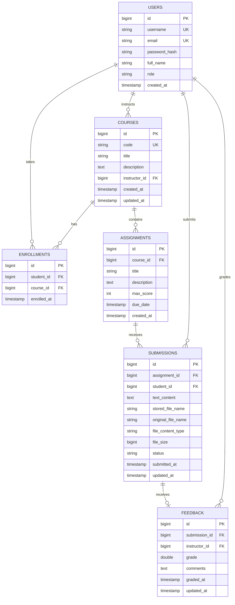

# Secure Learning Management System (LMS) & Assignment Module

A production-grade, secure Learning Management System (LMS) with an **Assignment & Submission Module** built with **Java 21**, **Spring Boot 3**, **Spring Security 6**, **Spring Data JPA**, **H2 / MySQL / PostgreSQL**, and a minimal, human-crafted web interface.

---

## 🚀 Key Features

- **Authentication & Role-Based Access Control (RBAC):**
  - Roles: `ROLE_STUDENT`, `ROLE_INSTRUCTOR`, `ROLE_ADMIN`.
  - Passwords hashed using **BCrypt** with salted rounds (strictly zero plaintext storage).
  - Stateless **JWT Authentication** (HMAC-SHA256).
- **Course & Academic Management:**
  - Instructors can create, edit, and manage courses and coursework.
  - Students can search, browse catalog offerings, and enroll in courses.
  - Role-specific dashboard views.
- **Assignment & Submission Module:**
  - Instructors publish assignments with scoring weights, instructions, and deadlines.
  - Students submit coursework (text response + file attachments) and view submission status.
  - Instructors review student submissions, download student attachments securely, assign grades, and provide feedback.
- **Defensive Cyber Security Architecture:**
  - **Stored XSS Prevention:** Integrated **OWASP Java HTML Sanitizer** policy stripping scripts, event handlers (`onload`, `onerror`), and unsafe protocols from all user inputs.
  - **IDOR / Access Control Defense:** Strict server-side verification ensuring students can **only** access/download their own submissions and instructors can **only** inspect/grade submissions for courses they instruct.
  - **Secure File Upload Pipeline:** Strict whitelist validation (`.pdf`, `.docx`, `.txt`, `.zip`, `.png`, `.jpg`, `.py`, `.java`, `.md`), path traversal protection (`..` prevention), size restriction (10MB max), and UUID file name isolation on disk.
  - **Standardized Error Handling:** `GlobalExceptionHandler` ensures stack traces and internal database errors are never exposed in API responses.

---

## 🛠️ Tech Stack

| Layer | Technology |
|---|---|
| **Language & Runtime** | Java 21 LTS |
| **Framework** | Spring Boot 3.3.3 |
| **Security** | Spring Security 6, JJWT 0.12.6, BCrypt |
| **Sanitization** | OWASP Java HTML Sanitizer |
| **Database** | H2 (default persistent file mode), MySQL 8+, PostgreSQL 14+ |
| **ORM / Persistence** | Spring Data JPA / Hibernate ORM |
| **Frontend UI** | HTML5, Vanilla JavaScript, Clean CSS Design System |

---

## 🗄️ Relational Database Schema



---

## ⚡ Quickstart & Running Locally

### 1. Prerequisites
- Java 21+ JDK
- Maven 3.9+
- Git

### 2. Run the Application
Execute the following in the repository root:

```bash
mvn spring-boot:run
```

Once started:
- **Web Application UI:** `http://localhost:8080`
- **H2 Web Console:** `http://localhost:8080/h2-console` (JDBC URL: `jdbc:h2:file:./data/lmsdb`, User: `sa`, Password: empty)

---

## 🔑 Pre-Seeded Demo Accounts

The application automatically seeds initial accounts for instant evaluation:

| Role | Username | Password | Full Name |
|---|---|---|---|
| **Admin** | `admin` | `Admin@12345` | System Administrator |
| **Instructor** | `instructor_alan` | `Instructor@12345` | Prof. Alan Turing |
| **Instructor** | `instructor_ada` | `Instructor@12345` | Dr. Ada Lovelace |
| **Student** | `student_alice` | `Student@12345` | Alice Smith |
| **Student** | `student_bob` | `Student@12345` | Bob Jones |

> **Tip:** You can click any pill in the **Quick Role Switcher** bar at the top of the web UI to sign in instantly with that account.

---

## 📡 REST API Catalog

### 1. Authentication
- `POST /api/auth/register` — Register a student or instructor.
- `POST /api/auth/login` — Login and receive a JWT Bearer token.
- `POST /api/auth/logout` — Logout session.
- `GET /api/auth/me` — Get profile details of the authenticated user.

### 2. Courses
- `GET /api/courses` — Browse all courses (supports `?search=` filter).
- `GET /api/courses/{id}` — Get single course details with syllabus.
- `POST /api/courses` — Create a course (*Instructor/Admin*).
- `PUT /api/courses/{id}` — Update course (*Course Instructor/Admin*).
- `DELETE /api/courses/{id}` — Delete course (*Course Instructor/Admin*).
- `POST /api/courses/{id}/enroll` — Enroll in course (*Student/Admin*).
- `GET /api/courses/my-courses` — List user's enrolled or authored courses.

### 3. Assignments
- `POST /api/assignments` — Create a coursework assignment (*Instructor/Admin*).
- `GET /api/assignments/{id}` — Get assignment details and current student submission status.
- `GET /api/assignments/course/{courseId}` — List all assignments in a course.
- `PUT /api/assignments/{id}` — Update assignment (*Course Instructor/Admin*).
- `DELETE /api/assignments/{id}` — Delete assignment (*Course Instructor/Admin*).

### 4. Submissions & Grading
- `POST /api/submissions` — Submit assignment with text and/or file attachment (*Student/Admin* - Multipart form).
- `GET /api/submissions/{id}` — View single submission (*Owner Student / Course Instructor / Admin*).
- `GET /api/submissions/assignment/{assignmentId}` — List submissions for an assignment (*Course Instructor / Admin*).
- `GET /api/submissions/my-submissions` — List all submissions by current student (*Student/Admin*).
- `PUT /api/submissions/{id}/feedback` — Grade submission and provide feedback (*Course Instructor / Admin*).
- `GET /api/submissions/{id}/download` — Securely download submitted file (*Owner Student / Course Instructor / Admin*).

### 5. Administration & Auditing
- `GET /api/users` — List registered users and assigned roles (*Admin only*).
- `GET /api/users/{id}` — Get user profile details (*Admin only*).

---

## 🧪 Testing with Postman / OWASP ZAP

### 1. Authenticating in Postman
1. Send `POST http://localhost:8080/api/auth/login` with body:
   ```json
   {
     "username": "student_alice",
     "password": "Student@12345"
   }
   ```
2. Copy the returned `token` from `data.token`.
3. In subsequent requests, add the HTTP header:
   ```
   Authorization: Bearer <your_jwt_token>
   ```

### 2. Testing IDOR / Access Control
- As `student_bob`, attempt to `GET /api/submissions/1` (Alice's submission).
- Verify the server responds with **403 Forbidden** and a clean error message:
  ```json
  {
    "success": false,
    "status": 403,
    "error": "Forbidden",
    "message": "Access denied: You do not have permission to access or modify this resource."
  }
  ```

### 3. Testing Stored XSS Mitigation
- Submit an assignment containing an XSS payload:
  ```html
  <script>alert('XSS')</script>Here is my clean report.
  ```
- Retrieve the submission via `GET /api/submissions/{id}`.
- Verify that OWASP HTML Sanitizer has stripped the malicious `<script>` and `onerror` attributes, leaving only safe content.

### 4. Testing File Upload Validation
- Attempt to upload an executable or script (`.exe`, `.sh`, `.jsp`, `.php`).
- Verify the server rejects the request with **400 Bad Request**:
  ```json
  {
    "success": false,
    "status": 400,
    "error": "File Validation Error",
    "message": "Executable or script file type (.exe) is strictly forbidden."
  }
  ```

---

## 🔄 Switching to MySQL or PostgreSQL

To connect to MySQL or PostgreSQL instead of H2, update `src/main/resources/application.properties`:

### MySQL:
```properties
spring.datasource.url=jdbc:mysql://localhost:3306/lms_db?useSSL=false&serverTimezone=UTC&allowPublicKeyRetrieval=true
spring.datasource.username=root
spring.datasource.password=your_password
spring.jpa.database-platform=org.hibernate.dialect.MySQLDialect
spring.jpa.hibernate.ddl-auto=update
```

### PostgreSQL:
```properties
spring.datasource.url=jdbc:postgresql://localhost:5432/lms_db
spring.datasource.username=postgres
spring.datasource.password=your_password
spring.jpa.database-platform=org.hibernate.dialect.PostgreSQLDialect
spring.jpa.hibernate.ddl-auto=update
```

---

## 📄 License
MIT License. Developed for secure training and academic demonstrations.
